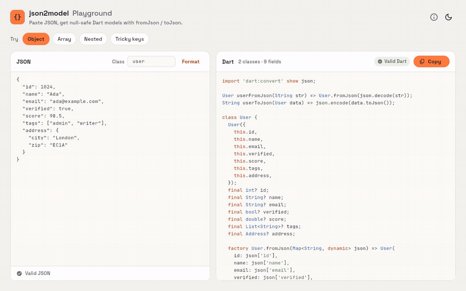
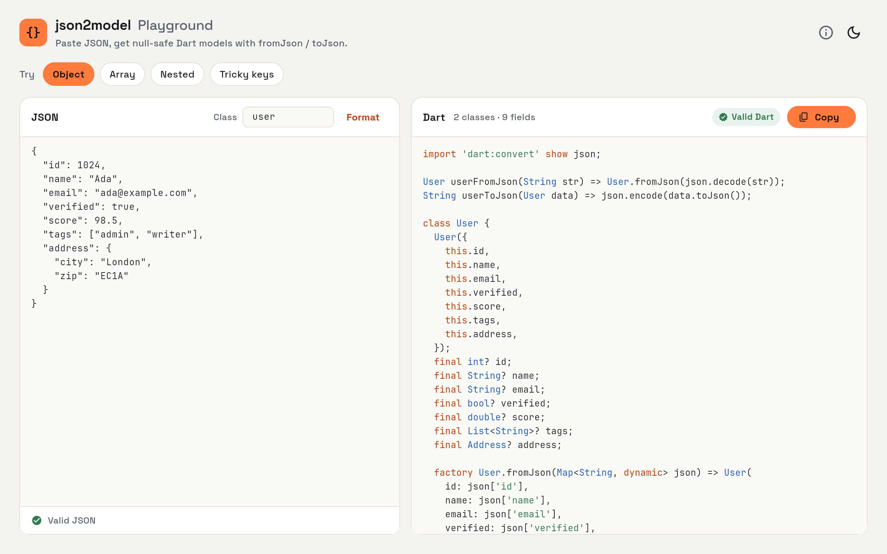
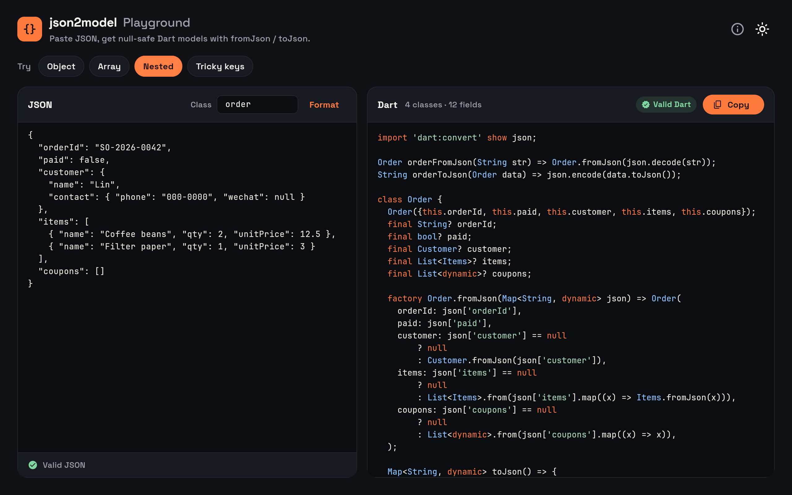
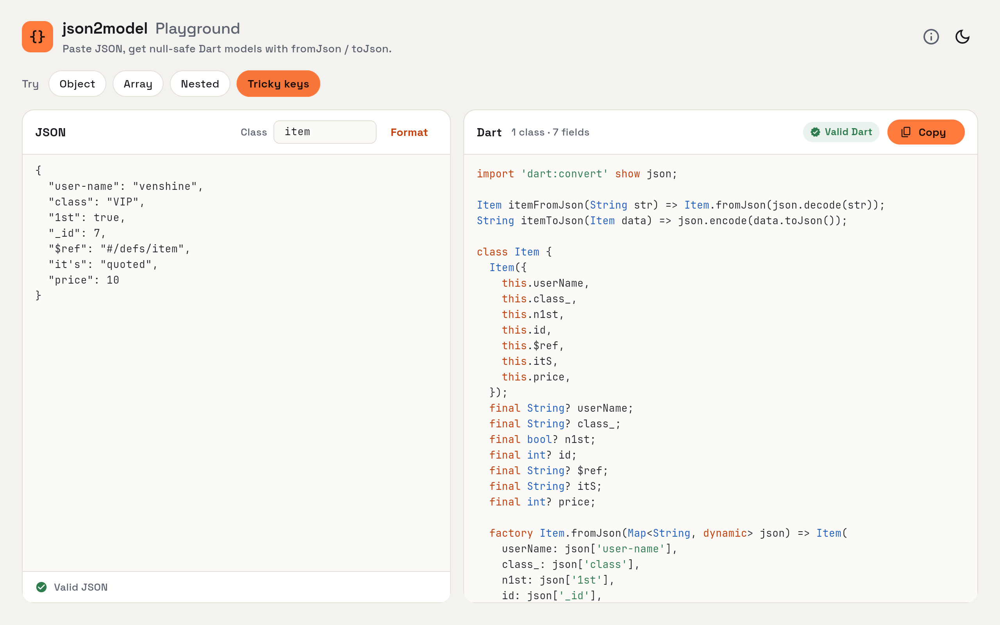
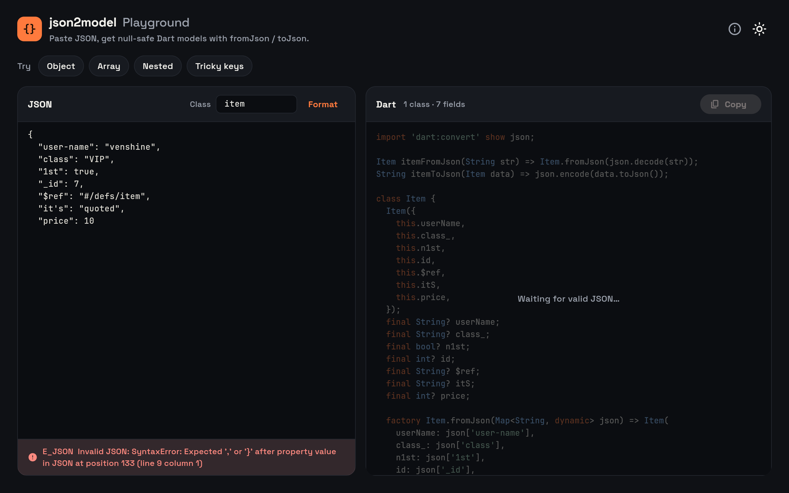
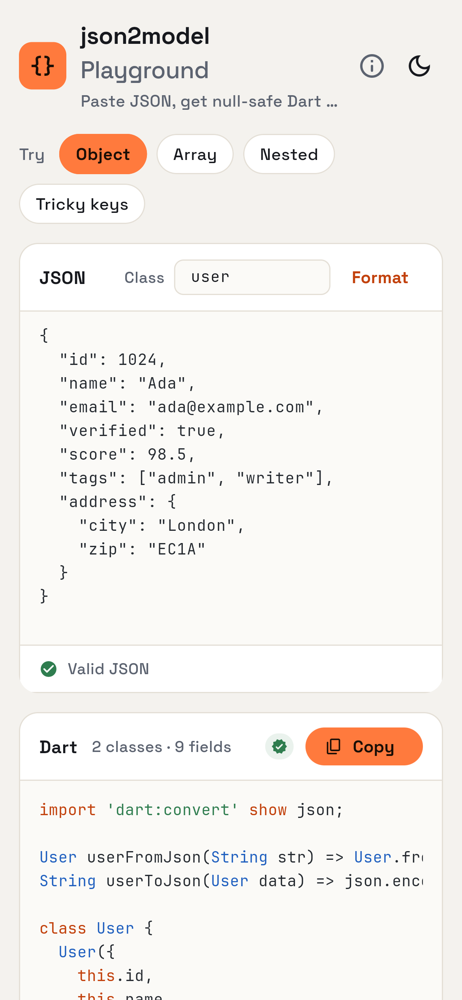

# json2model [](https://pub.dev/packages/json2model) [](https://github.com/venshine/json2model/actions/workflows/ci.yml)

[English](https://github.com/venshine/json2model/blob/main/README.md) | 简体中文

在代码中执行命令，根据 JSON 字符串生成对应的 Dart 模型类。
[https://pub.dev/packages/json2model](https://pub.dev/packages/json2model)

## 在线体验（Playground）

**[在线试用 →](https://venshine.github.io/json2model/)**

[Flutter Web 示例](https://github.com/venshine/json2model/tree/main/sample) 可以在浏览器里直接试用：粘贴 JSON 即可得到模型代码，每次生成的结果都会经过 Dart 解析器校验。



| 对象 | 嵌套（深色） | 非法标识符 key |
|:---:|:---:|:---:|
|  |  |  |

| JSON 错误提示 | 手机窄屏 |
|:---:|:---:|
|  |  |

本地运行：

```bash
cd sample
flutter run -d chrome
```

## 用法

简单示例：

```dart
import 'package:json2model/json2model.dart';

void main() {
  run(['--src=example/json', '--dst=example/lib/models']);
}
```

## 功能
| 功能                       | 状态     |
| :----                     |     ---: |
| 空安全（null safety）        |       ✅ |
| toJson 和 fromJson          |       ✅ |
| encoder 和 decoder          |       ✅ |
| 所有属性为 final             |       ✅ |
| 所有属性可选                 |       ✅ |

## 问题反馈

功能建议和 bug 请提交到 [issue 列表][tracker]。

[tracker]: https://github.com/venshine/json2model/issues

## 关于
[venshine.cn@gmail.com](venshine.cn@gmail.com)

## 致谢

Playground 打包了 [Space Grotesk](https://github.com/floriankarsten/space-grotesk) 和 [JetBrains Mono](https://github.com/JetBrains/JetBrainsMono) 两款字体，均采用 [SIL Open Font License 1.1](https://openfontlicense.org) 协议。

## 许可证
[BSD 3-clause](https://opensource.org/license/bsd-3-clause/)
