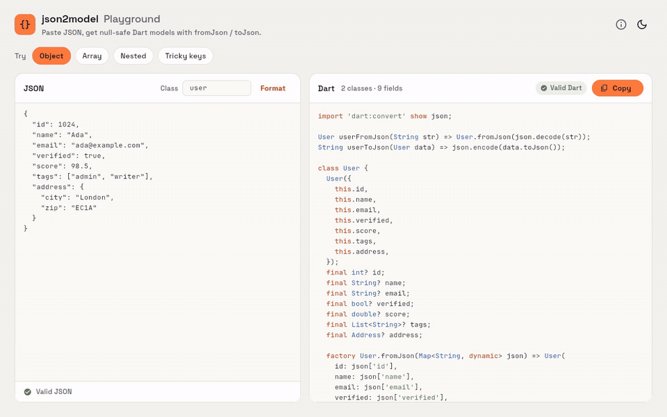
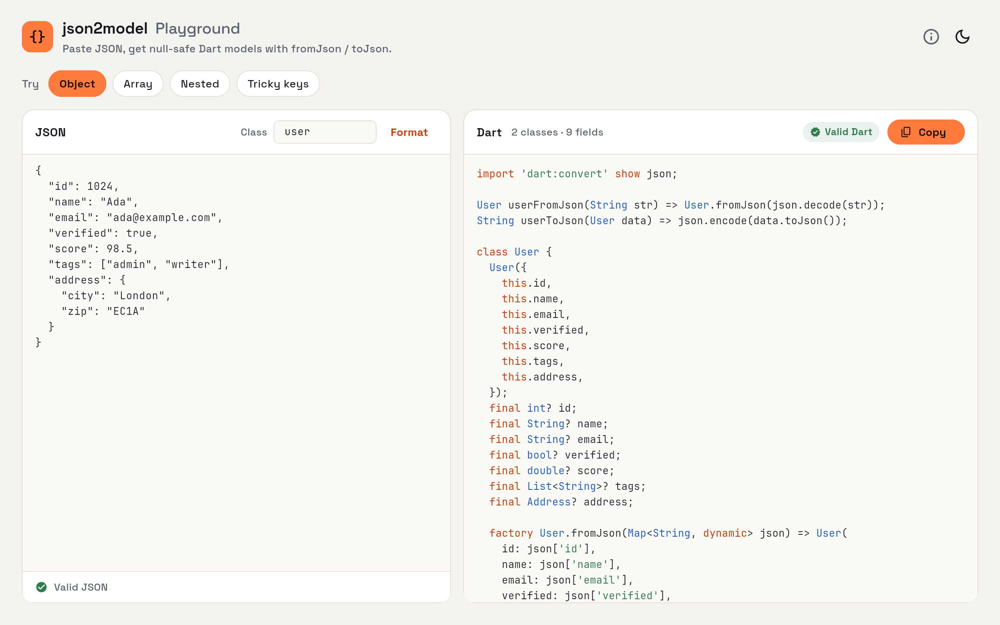
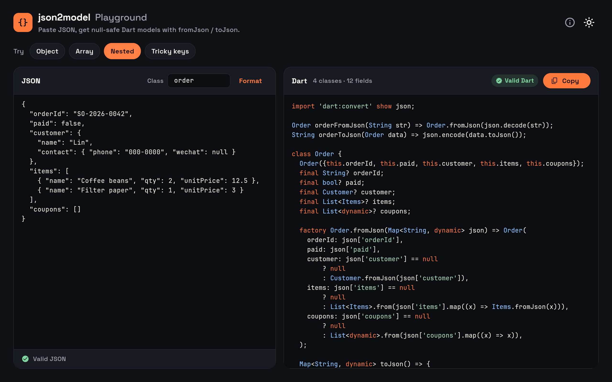
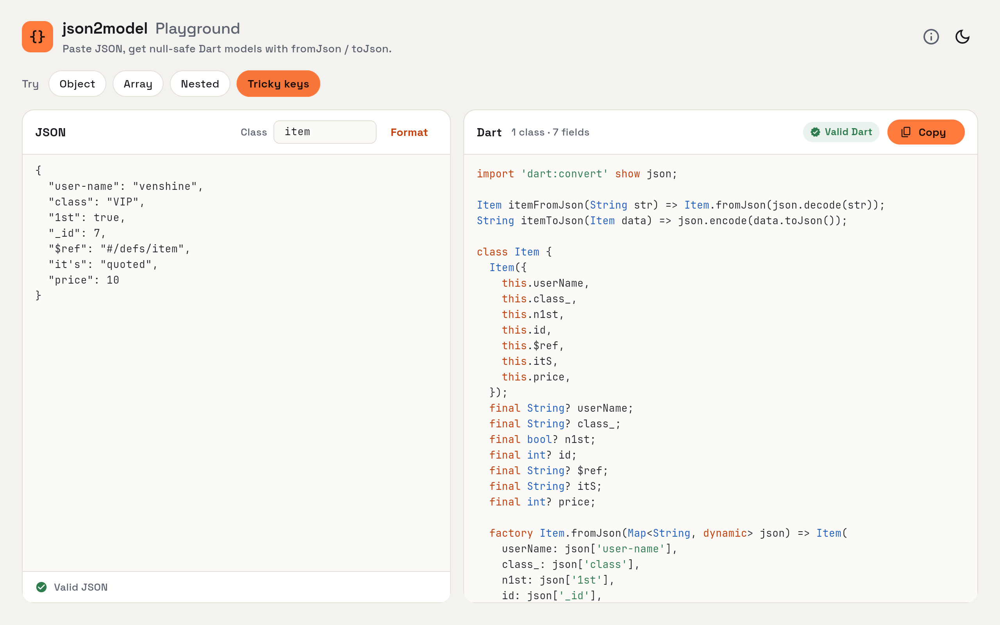
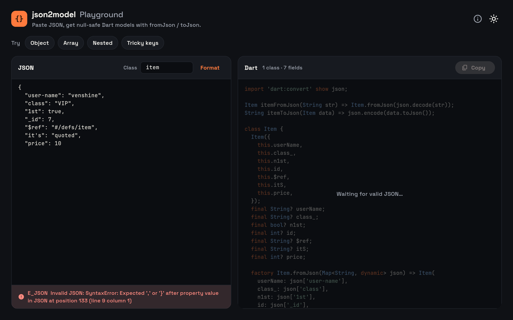
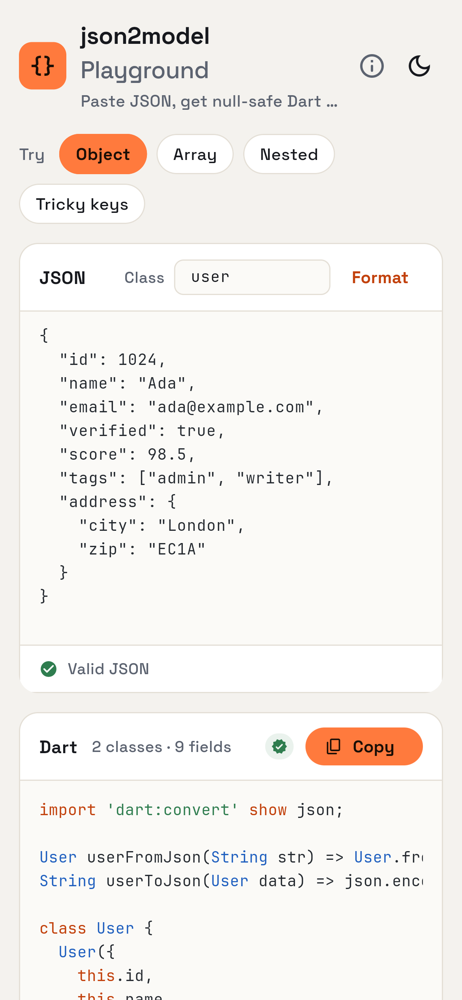

# json2model [](https://pub.dev/packages/json2model) [](https://github.com/venshine/json2model/actions/workflows/ci.yml)

English | [简体中文](https://github.com/venshine/json2model/blob/main/README-CN.md)

This library generates a model object corresponding to a JSON string by executing commands in code
[https://pub.dev/packages/json2model](https://pub.dev/packages/json2model)

## Playground

**[Try it online →](https://venshine.github.io/json2model/)**

The [Flutter web playground](https://github.com/venshine/json2model/tree/main/sample) runs the generator in the browser: paste JSON, get the model, and every result is checked by the Dart parser.



| Object | Nested (dark) | Keys that are not identifiers |
|:---:|:---:|:---:|
|  |  |  |

| Invalid JSON | Mobile |
|:---:|:---:|
|  |  |

Run it locally:

```bash
cd sample
flutter run -d chrome
```

## Usage

A simple usage example:

```dart
import 'package:json2model/json2model.dart';

void main() {
  run(['--src=example/json', '--dst=example/lib/models']);
}
```

## Feature
| Feature                   | Status   |
| :----                     |     ---: |
| null safety               |       ✅ |
| toJson & fromJson         |       ✅ |
| encoder & decoder         |       ✅ |
| all properties final      |       ✅ |
| all properties optional   |       ✅ |

## Bugs

Please file feature requests and bugs at the [issue tracker][tracker].

[tracker]: https://github.com/venshine/json2model/issues

## About
[venshine.cn@gmail.com](venshine.cn@gmail.com)

## Credits

The playground bundles [Space Grotesk](https://github.com/floriankarsten/space-grotesk) and [JetBrains Mono](https://github.com/JetBrains/JetBrainsMono), both under the [SIL Open Font License 1.1](https://openfontlicense.org).

## License
[BSD 3-clause](https://opensource.org/license/bsd-3-clause/)
